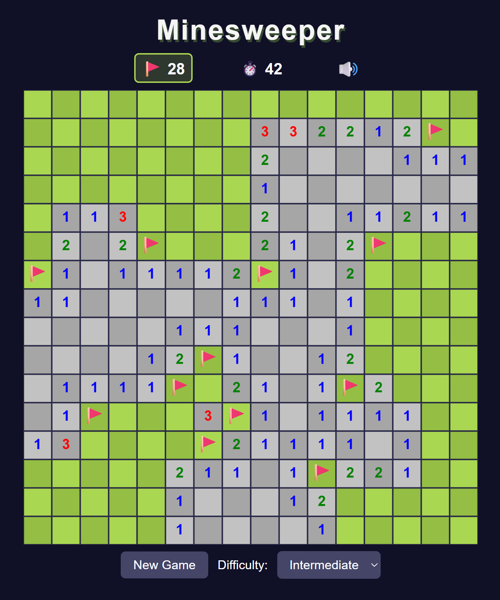

# Minesweeper

A modern, browser-based version of the classic Minesweeper puzzle game, built with vanilla JavaScript and HTML Canvas.

Reveal safe cells, use the numbered clues to locate hidden mines, and clear the board without triggering an explosion.

**[▶ Play Minesweeper](https://fredwahab.github.io/Minesweeper/)**



## How to Play

The goal is to reveal every cell that does not contain a mine.

- **Reveal cells** to uncover empty spaces or numbered clues.
- **Read the numbers.** Each number tells you how many mines are hidden in the eight surrounding cells.
- **Flag suspected mines** to keep track of dangerous cells.
- **Clear all safe cells** to win the game.
- **Avoid revealing a mine**, or the game ends!

The first reveal is always an empty cell, giving you a safe starting area.

### Controls

| Action | Desktop | Mobile / Touchscreen |
|---|---|---|
| Reveal a cell | Left-click in Reveal mode | Tap in Reveal mode |
| Place or remove a flag | Right-click, or left-click in Flag mode | Tap in Flag mode |
| Switch Reveal / Flag mode | Click the flag counter (🚩) | Tap the flag counter (🚩) |
| Pause or resume | Click the timer | Tap the timer |
| Start a new game | New Game button | New Game button |
| Change difficulty | Difficulty dropdown | Difficulty dropdown |
| Mute or unmute audio | Speaker button | Speaker button |

**Flag Mode:** Select the flag counter above the board to toggle Flag mode. A green outline indicates that Flag mode is active. While active, normal clicks or taps place and remove flags instead of revealing cells.

Right-clicking on desktop always toggles a flag, regardless of the selected mode.

Starting a new game automatically returns to Reveal mode.

**Pause:** Select the timer to pause the game. The board is covered by a pause dialog until Resume Game is selected, and the timer stops while paused.

### Difficulty Levels

| Difficulty | Board Size | Mines |
|---|---|---|
| Beginner | 9 × 9 | 10 |
| Intermediate | 16 × 16 | 40 |
| Expert | 16 × 30 | 99 |

The game starts on Intermediate difficulty. Changing difficulty creates a new board.

On devices with different screen orientations, rectangular boards are automatically transposed to better fit the available space. Board dimensions change orientation without changing the number of cells or mines.

## Features

- Three classic difficulty levels
- Randomized mine placement
- Guaranteed empty first reveal
- Automatic flood reveal of connected empty cells
- Numbered clues with traditional Minesweeper colors
- Flag placement and remaining-flag counter
- Reveal/Flag mode toggle for desktop and mobile
- Game timer that starts on the first reveal
- Pause and resume functionality
- Win and loss detection
- Win/loss dialogs and New Game functionality
- Sound effects with mute/unmute controls
- Responsive board scaling with square tiles
- Automatic board transposition between portrait and landscape
- Landscape mobile layout with controls beside the board
- High-density display support
- Hover highlighting for available cells
- Custom mine and flag graphics
- Automatic deployment to GitHub Pages

## Technology

Minesweeper was developed without a game engine or frontend UI framework.

| Technology | Purpose |
|---|---|
| JavaScript (ES Modules) | Game logic, state management, and input handling |
| HTML5 Canvas | Board rendering, numbers, mines, and flags |
| CSS3 | Responsive layout, controls, styling, and dialogs |
| Browser Audio APIs | Playback and management of sound effects |
| Vite | Local development and production builds |
| GitHub Actions | Automated builds and deployment |
| GitHub Pages | Static website hosting |

## Technical Overview

The game uses a two-dimensional array to represent the board. Each cell stores its mine status, reveal status, flag status, and number of adjacent mines.

The application separates board logic, game state, rendering, input handling, audio, configuration, and user interface management into dedicated JavaScript modules.

### Board Generation

When a new game starts:

1. An empty board is created using the selected difficulty settings.
2. Mines are randomly distributed across the board.
3. Each safe cell is assigned its adjacent mine count.
4. The board is rendered to the canvas.

### First-Click Protection

The first revealed cell and its surrounding neighbors are guaranteed to contain no mines.

Any mines initially placed within that protected area are relocated to available cells elsewhere on the board. Adjacent mine counts are then recalculated.

This guarantees that the first reveal triggers an empty-area expansion while preserving the selected difficulty's total mine count.

### Cell Revealing

The game uses a flood-reveal algorithm.

When a cell with zero adjacent mines is revealed, the game automatically reveals its neighboring cells. The process continues through connected empty cells until numbered cells form the boundary.

Flagged and previously revealed cells are skipped.

### Win and Loss Detection

The game is won when every non-mine cell has been revealed. Correctly flagging every mine is not required.

Revealing a mine ends the game, stops the timer, and displays the remaining mines.

### Game State and Timer

Game state management is handled separately from the renderer and user interface.

The game tracks the current difficulty, board state, revealed cells, flags, elapsed time, pause status, and win/loss conditions.

The timer begins on the first reveal rather than when the board is generated.

Pausing suspends gameplay and timer progression until the player resumes.

### Responsive Layout and Board Orientation

The application supports portrait and landscape layouts across desktop and mobile browsers.

In portrait mode, the title and status indicators appear above the board, with the game controls below it.

On shorter landscape screens, the board occupies the left side while the title, status indicators, difficulty controls, and footer are arranged in a right-hand sidebar.

Rectangular game boards are transposed when needed to accommodate the current orientation.

This preserves the complete grid and its mine count while providing a more suitable layout for the available screen dimensions.

If the device orientation changes during a game, the existing board is transposed rather than regenerated, preserving the player's progress.

### Canvas Rendering and Input

The board is drawn using the Canvas 2D API.

The renderer uses fixed logical cell coordinates while calculating the displayed Canvas dimensions from the available container space.

This allows the board to grow or shrink while maintaining square cells and preserving its aspect ratio.

Device pixel ratio is considered when sizing the Canvas backing buffer to improve rendering on high-density displays.

Mouse and touch coordinates are converted from displayed Canvas dimensions into logical board coordinates, keeping cell selection accurate regardless of scaling.

The flag-mode toggle allows touchscreen users to place and remove flags without requiring a right-click.

### Audio

Sound effects are managed through a dedicated audio module.

Audio assets are loaded using paths compatible with both Vite's development environment and the GitHub Pages deployment base path.

The player can mute or unmute sound effects through the speaker control.

## Running Locally

### Prerequisites

- Node.js
- npm
- Git

### Installation

Clone the repository:

```bash
git clone https://github.com/FredWahab/Minesweeper.git
cd Minesweeper
```

Install dependencies:

```bash
npm install
```

Start the development server:

```bash
npm run dev
```

Open the local URL displayed in the terminal.

### Production Build

Generate a production build:

```bash
npm run build
```

The generated files are placed in the `dist/` directory.

To preview the production build locally:

```bash
npm run preview
```

## Deployment

The game is hosted on GitHub Pages:

**https://fredwahab.github.io/Minesweeper/**

Deployment is automated using GitHub Actions.

When changes are pushed to the `master` branch, the deployment workflow:

1. Checks out the repository.
2. Installs Node.js and project dependencies.
3. Builds the project using Vite.
4. Uploads the generated production files.
5. Deploys the build to GitHub Pages.

The Vite configuration uses `/Minesweeper/` as its base path for GitHub Pages hosting.

## Future Improvements

Potential enhancements for future versions include:

- Optional long-press flag placement on touchscreens
- Additional accessibility and keyboard controls
- Additional game modes and customization options
- Localization and multilingual support
- Expanded animations and visual effects
- Additional audio options

## Author

**Fred Wahab**

[GitHub](https://github.com/FredWahab)

---

Built as a browser game development and JavaScript portfolio project.
